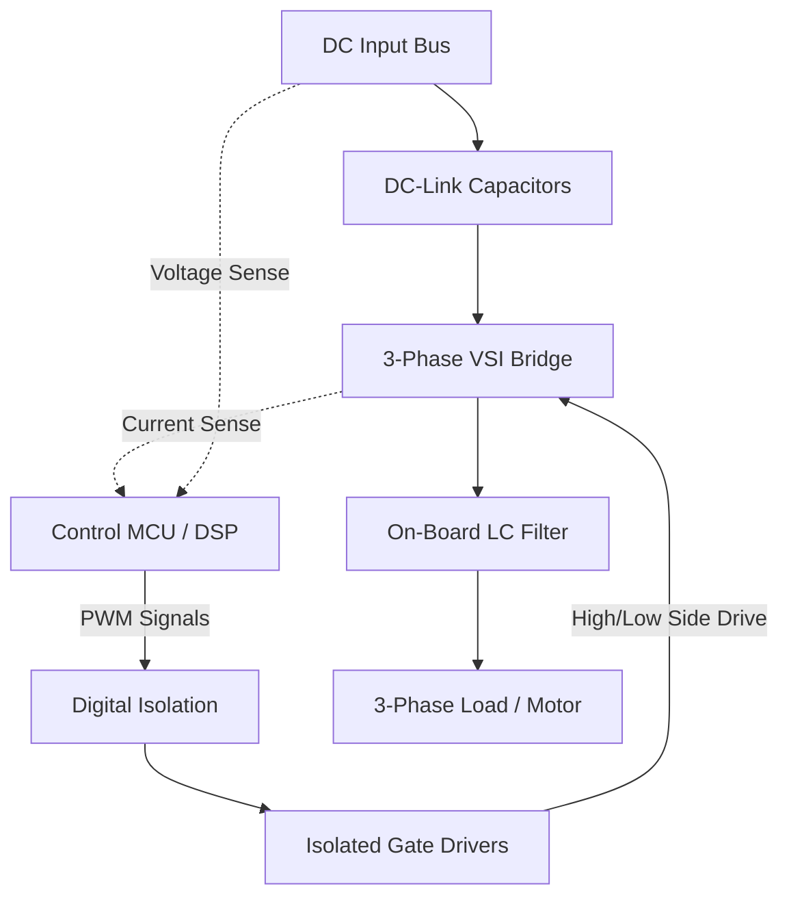

This article describes the architecture and layout choices for a three-phase inverter board tested at 500 W continuous power. The main design concerns include switching loops, heat removal, gate drive, and protection.

The linked **[inverter board](https://github.com/wayri/3-Phase-inverter-board)** provides the project context. The sections below focus on its supporting circuits and physical layout.

---

### System Architecture

The core topology is a three-phase, two-level voltage-source inverter (VSI). The supporting circuits handle sensing, gate drive, and filtering.



#### The DC-Link and Decoupling
The DC-link capacitor bank supplies switching current near the bridge. Excess series resistance (ESR) raises capacitor heating, while loop inductance (including capacitor ESL) contributes to voltage overshoot during switching.

To mitigate this, the board supports multiple capacitor footprint options, allowing for a mix of bulk electrolytic capacitors (for low-frequency energy storage) and high-frequency ceramic/film capacitors placed immediately adjacent to the switching nodes.

---

### Gate Drive and Isolation

Gate-drive timing affects switching loss, voltage overshoot, and electromagnetic interference (EMI). Faster edges can reduce transition loss but may increase ringing.

```ascii
     +HV DC
       |
     | D |  (High-Side Switch)
     +---+
       |--------> Phase Output (U, V, W)
     +---+
     | D |  (Low-Side Switch)
       |
      GND
```

The gate-drive path uses:
1. **Digital isolators** to separate control signals from the power stage.
2. **Gate drivers** sized for the selected MOSFETs and switching rate.
3. **Overcurrent protection provisions**, whose sensing and shutdown method depend on the final switch and driver choices.

---

### Output Filter Design

PWM output contains switching-frequency components. Where the load or interface requires lower ripple, an output filter can attenuate those components; its values depend on the application.

This board includes **on-board filter options**.
- The **inductor ($L$)** limits current ripple and must be checked for saturation at the expected peak current.
- The **capacitor ($C$)** provides a high-frequency current path; its connection and rating depend on the chosen filter topology.

The filter is integrated on the board to keep high-frequency current paths short and make EMI easier to manage.

---

### Physical Layout & Thermal Management

PCB layout affects voltage spikes, thermal behavior, and reliability, even when the schematic is sound.

**Key Layout Principles Applied:**
1. **Minimizing Commutation Loops**: The loop from the DC-link capacitor, through the high-side switch, through the low-side switch, and back to the capacitor must be physically as small as possible to minimize parasitic inductance ($L_{loop}$). High $L_{loop}$ combined with high $di/dt$ causes destructive voltage spikes ($V = L \cdot di/dt$).
2. **Thermal Planes**: The copper pours carrying phase currents are sized not just for electrical resistance, but as thermal radiators. 
3. **Trace Clearance**: Ensuring adequate creepage and clearance distances between the high-voltage DC bus and the low-voltage control circuitry to prevent arcing.

### Conclusion

The board is a test platform for motor-control and power-conversion work. Switching speed, layout, thermal design, and clearances all need to be considered together.
