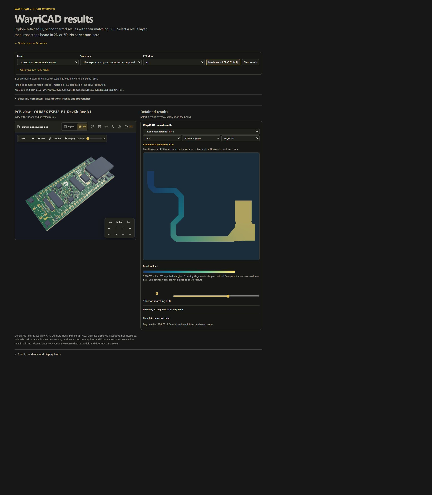
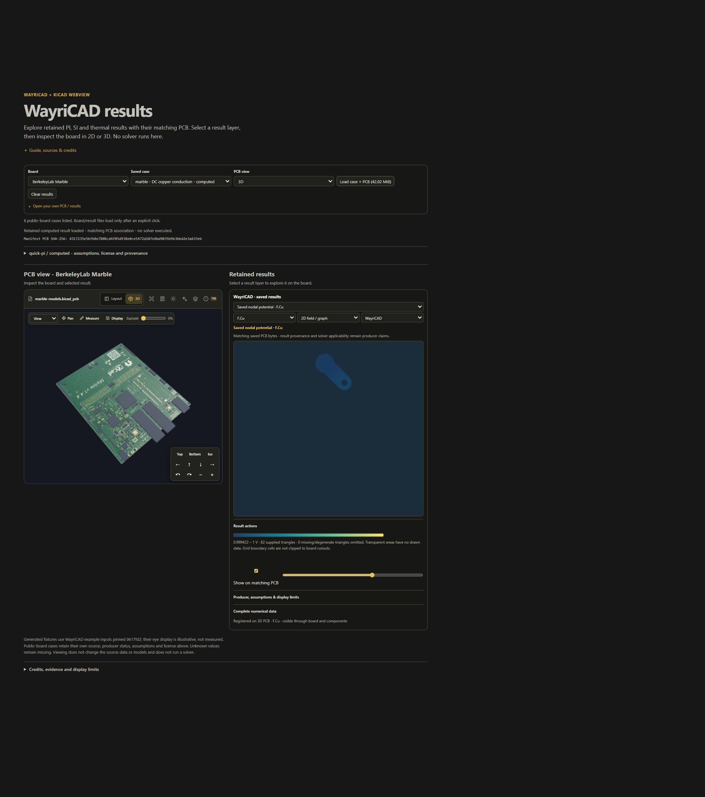

[Open the saved-result demo](/assets/demos/wayricad-results.html) · [Public-board cases](/assets/demos/wayricad-results.html?gallery=public) · [WayriCAD tools](/wayricad/) · [Complete library API and limits](https://github.com/wayri/kicad-webview/blob/v0.7.0/docs/WAYRICAD-RESULTS.md)

## From native tools to a browser

Use WayriCAD to compute the study, then use **Save results / Pocket KiVi** to retain its portable companion. This demo uses the self-hosted KiCad WebView **0.7.0** SDK to read those existing JSON structures and display the saved values beside the matching native PCB. It does not run the solver, execute a report, modify a design or fetch source paths found inside a result.

Keep the **original solve-time saved PCB fingerprint** and its corresponding PCB. A fresh hash of a changed board cannot establish where an older result came from. See [WayriCAD’s pinned export contract](https://github.com/wayri/WayriCAD/blob/0617fd201c0817d95648cec639744138aa59fe20/docs/POCKET_KIVI_EXPORT.md).

| Tool | Visualize retained output | Connection to the design |
| --- | --- | --- |
| Quick PI | Triangular potential, cell power and current-density fields, with missing regions left transparent | A matching hash and declared KiCad XY millimetres allow a PCB field overlay, including supported saved layers/elevations in native 3D. |
| Quick SI | Route impedance, step responses and saved eye traces | Explicit saved net names and segment UUIDs support source cross-highlighting on the matching PCB; curve labels do not infer connectivity. |
| QuickTherm | Supported steady grids and saved layer-major time frames | Probe cells, graph their retained history and use a fixed field scale across saved frames. |
| Other/unsupported structures | Complete paged numerical data and JSON download | No fabricated plot, geometry, unit conversion or source binding is added. |

Independent 3D field views use only supplied XYZ or an explicit saved layer elevation. They retain source coordinates, the producer’s elevation basis and source-unit probes. Values are not turned into invented heights. Unknown elevation stays in the 2D view. Use **Show on matching PCB** to register the field on the native 2D/3D board. Supported front-depth/board-center elevations map onto the actual board; without saved Z only explicitly named F.Cu/B.Cu surfaces are placed. Fields show through the substrate and models, with that presentation labelled. PCB layer visibility is respected.

## Embed both views without Node.js

```html
<div id="board" style="height:420px"></div>
<div id="results"></div>
<script src="https://wayri.github.io/assets/lib/kicad-webview/releases/0.7.0/kicad-webview.min.js"></script>
<script type="module">
  const board = new KiCadWebView.Viewer('#board', {theme:'dark'});
  await board.load('/designs/board.kicad_pcb');
  const results = new KiCadWebView.WayriCADResultsViewer('#results', {
    theme:'dark', boardViewer:board
  });
  await results.loadURL('/results/board.quick-pi.pocket-kivi.json');
  results.setBoardOverlay(true);
  await board.setView('3d');
  window.addEventListener('pagehide', () => {
    results.dispose();
    board.dispose();
  }, {once:true});
</script>
```

Host the script, source and result yourself, or use the versioned self-hosted script above. Normal CORS and authorization apply. No rendering server or runtime Node installation is required. The ES module exports the same names; the `/results` npm entry and `dist/wayricad-results.js` offer the result component separately.

`results.load(jsonOrObject,{path})` accepts already supplied data without fetching. The demo’s local file pickers keep your files in the browser. Review the full result JSON, including any filesystem/model metadata, before sharing it. [Quick start](/kicad-webview/docs/quick-start/) · [Hosting](/kicad-webview/docs/hosting/).

## Layers and linked views

Choose **Saved result layer** to retain the quantity while moving between saved layers. Use the PCB Layers panel to show or hide copper; hidden layers hide the corresponding overlay. The active result layer stays pinned while inspecting the board. Click a saved field or a PCB part/trace to link probe markers. Registered 3D clicks retain their exact hit value and elevation. Spatial probe links do not infer electrical connectivity.

The 0.4.0 SDK adds `getResultLayers()`, `setLayer(name)`, `setBoardOverlay(boolean)` and `getBoardOverlayState()`. `Viewer.getSelectionPosition()` exposes a saved anchor or segment midpoint, or null. npm/CDN 0.3.0 remains available for the prior APIs; use the self-hosted 0.4.0 files for these additions.

## Inspect, probe and cross-select

Choose a saved plot, then click to probe an original retained cell/sample or interpolate inside a supported saved nodal triangle. Curves break across missing values and retain repeated event times. SI data stays on its supplied axis; it is not painted over copper as a made-up spatial field.

For transient thermal data, move **Saved frame** to a retained time, probe a cell and choose **Plot probe history**. **Return to saved field** restores the field and frame. The scale remains fixed over that layer’s saved frames. Both 2D and 3D use the same palette/range; a labelled vertex-color fallback may be used if the scalar shader cannot run, while numerical probes remain exact to the supported saved interpolation.

On a verified matching PCB, **Highlight saved net** and **Locate saved route** use the exporter’s exact name/UUIDs. Selecting a matching PCB object or net reports its source match in the results panel. Unmatched and ambiguous targets remain unlinked. Source replacement disables association until it has been checked again.

## Source state is separate from result validity

- **Matching:** the declared saved PCB SHA-256 equals the loaded bytes. This is byte association, not authentication, solver qualification or a measured result.
- **Stale:** the declared hash differs. PCB overlays and source actions are disabled; historical numerical results remain readable independently.
- **Unverified:** missing, unsaved, ambiguous or unsupported source evidence. Independent supported plots and the full data remain available.

Canonical `wayricad.project-result/v1` library records are not independently content-identity-verified by this adapter, so their PCB association remains unverified. Use a supported portable companion with its retained saved-source evidence for registration. [Producer save/load documentation](https://github.com/wayri/WayriCAD/blob/0617fd201c0817d95648cec639744138aa59fe20/docs/PROJECT_RESULTS.md).

## Display and mobile limits

Inputs are JSON only, limited to 64 MiB with depth/work bounds. Duplicate keys and nonfinite input numbers are rejected. Large datasets need an explicit Load action, especially on phones. Full arrays, nulls and producer metadata remain in the frozen result and JSON download; the paged data browser avoids expanding every cell into the page.

The default graph selects up to four ordinary series or 32 eye traces and shows at most 100,000 selected points, with the limit and selection count visible. Grid cell edges follow adjacent saved center spacing; boundary cells are not clipped to copper, board outlines or openings. A singleton or unordered axis does not establish an area surface. Unsupported geometry remains numerical data. These display choices are not additional solver calculations.

3D rendering is demand-driven and pauses when unavailable/off-screen. Keep a stable mount height, dispose on unmount, and test representative files on the intended host/device. Physical-phone performance and compatibility with every application sandbox are not established by the desktop browser checks.

## Public-board cases and source identity

The demo separates **Generated fixtures** from manifest-listed public boards.
Choose a board and retained case to see the producer status, assumptions,
limitations, original summary, source size, full SHA-256, upstream link,
license and execution-provenance link. Status is copied from the manifest,
not promoted to a pass verdict. Nulls and unknowns are not replaced by made-up
measurements, current ratings, plots or units.

**Load case + PCB** explicitly downloads both retained data and the matching
saved board. Public-board files do not auto-load on scroll, selection or a
deep link, including large Marble PCBs. The **2D / 3D** selector uses the same
board viewer. Supported PI/thermal fields, declared layer/elevation overlays,
SI curves, thermal histories and full numerical data use the existing result
renderer; unavailable structures remain explicit rather than being fabricated.

In the retained public-board cases, PI fields register on the exact PCB in 2D
and 3D. The 0.7.0 steady-thermal adapter displays independent 2D temperature maps
but does not propagate their saved layer/Z metadata into a board overlay or a
standalone 3D field. Correct hashes are not a placement guarantee. The SI cases
retain route-impedance screens; incomplete channel evidence leaves the eye
unavailable. These limits are visible in the case evidence and full JSON.

The displayed source hash belongs to the **case-specific saved PCB**. A native
copy, for example one with model-path normalization, can differ from the raw
upstream Marble file. An upstream repository URL and a model-provenance entry
are not interchangeable byte-identity evidence. Only load the saved copy whose
bytes match the solve-time fingerprint in the retained result. A fresh hash
must not be attached to an older result to force association. The SDK's matching,
stale and unverified states still gate registration and source actions.

Each case's provenance links to its producer inputs and limitations. The native
generation workflow is documented in [WayriCAD's public-board example guide](https://github.com/wayri/WayriCAD/blob/develop/docs/examples/public-boards/README.md).
Hardware, copied sources, generated results, third-party models and the viewer
retain their separately declared licenses; public availability is not itself
a license or a claim of validation. Public-board studies are retained native
producer outputs under explicit assumptions, not browser calculations or
hardware measurements. Failed, provisional or unavailable cases remain labelled.

### Actual Public-Board Captures





Unmodified local source-preview captures using the published 0.7.0 SDK; not
hardware measurements or evidence of every host/device. The retained numerical
arrays, producer inputs and source hashes are available from each gallery case.

### Site Manifest Contract

The UI loads only the small, site-owned catalogue at
`assets/demos/wayricad-results/public-boards/manifest.json` (maximum 512 KiB).
Its schema is `wayricad.integration-gallery/v1`, with `boards` (maximum 64) and
flat `cases` (maximum 512). Board records require unique string `id` and `name`.
Additional board metadata is allowed but is not used to guess operating inputs.

Every case requires the following fields:

| Field | Contract |
| --- | --- |
| `id`, `board_id` | Unique case ID, and an existing board ID. IDs match `[a-z0-9][a-z0-9_-]{0,95}`. `fixtures` is a reserved board ID; the four generated fixture IDs are reserved case IDs. |
| `label`, `kind`, `status` | Nonempty display strings; label <=256 characters, kind/status <=80. Status is displayed verbatim without inferring success. |
| `result_path` | Relative `.json` path under the manifest directory, or `null` when no retained result is available. Null disables Load. |
| `source_path` | Relative `.kicad_pcb` path under the manifest directory, or under `../../public-hardware/`. This names the exact case-specific saved copy. |
| `source_sha256`, `source_bytes` | 64 hexadecimal characters and a positive integer size <=64 MiB. The manifest hash is displayed as declared identity, not independently substituted into the result. |
| `assumptions`, `limitations` | Arrays of strings, each <=128 entries, each string <=4096 characters. Empty arrays are allowed and labelled as no declarations. |
| `summary` | A string <=8192 characters, a JSON object with <=64 top-level keys / depth <=8 / serialized length <=16384 characters, or `null`. Numbers must be finite; keys, nulls and values are displayed without inventing units. |
| `provenance_path` | Relative `.json`, `.md` or `.txt` under the manifest directory. |
| `upstream_url` | Absolute HTTP(S) link without embedded credentials; displayed only as an explicit outbound link. |
| `license` | A nonempty string, or `{name, url}` with an HTTP(S) license link. String-only licenses are displayed without inventing a license URL. |

Asset paths are <=512 characters and use only ASCII letters, digits, `_`, `-`,
`.` and `/`. They resolve relative to the **manifest URL**, not a result's
metadata. Absolute paths, schemes, query/fragment components, backslashes,
percent-encoded paths and escapes outside the approved directories are rejected.
Upstream/license links never become PCB or result fetch destinations. Result
JSON cannot control a source URL fetched by this demo.

`?case=ID` preselects only a case ID from the validated catalogue, without
downloading its PCB/result. Unknown IDs do not become paths or URLs.
`?gallery=public` selects the first available public board from the catalogue;
it also requires an explicit Load click. A late catalogue response cannot
replace local files or a newer user selection. Selection changes abort pending
loads and clear stale result overlays. Closing the page aborts catalogue and
case loads and disposes both viewers. If the catalogue is missing or invalid,
the four generated fixtures and local-file mode remain available.

## Generated fixture evidence and acknowledgements

The demo uses public WayriCAD saved-board examples pinned to [0617fd2](https://github.com/wayri/WayriCAD/tree/0617fd201c0817d95648cec639744138aa59fe20/docs/examples/pocket-kivi). PI/thermal use the included generated two-layer PCB; SI uses its documented complete-channel derivative. These are computed example producer outputs under declared assumptions, **not measured hardware or production designs**. The eye display is illustrative. No solver was rerun for this WebView integration.

Original sample arrays and metadata spelling are retained, including legacy encoded unit strings; known plot labels follow the producer’s field conventions. No numerical unit conversion occurs. See [the original assumptions and producer provenance](https://github.com/wayri/WayriCAD/blob/0617fd201c0817d95648cec639744138aa59fe20/docs/examples/pocket-kivi/README.md), [retained demo credits](/assets/demos/wayricad-results/CREDITS.md) and [upstream example notice](/assets/demos/wayricad-results/UPSTREAM-LICENSE). Upstream design/example terms remain separate from WebView’s MPL-2.0 license.

[Development acknowledgements, including AI assistance](/kicad-webview/docs/acknowledgements/) · [License and optional support](/kicad-webview/docs/license/) · [Library result API](https://github.com/wayri/kicad-webview/blob/v0.4.0/docs/WAYRICAD-RESULTS.md).


## Field palettes

A matching 0.7 build adds WayriCAD, Viridis, Inferno and Grayscale choices shared by the 2D plot, standalone 3D field and registered board overlays. Palette changes retain supplied scalar values, units, ranges, probes and source association. Missing samples stay missing. These palettes are released in 0.7.0; the live results demo uses the matching SDK. See [release availability](/kicad-webview/docs/releases/).
